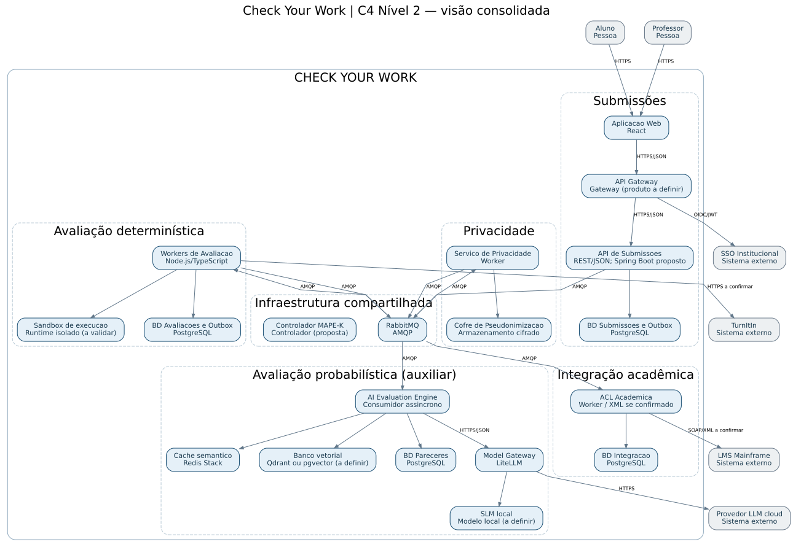

# Check Your Work — Architectural Kata
**Engenharia de Software • 6º Período • Turma de quinta-feira • UniSENAI PR • Equipe 02 • Sprint 4**  
Professor orientador: Sidney. Documentação consolidada para revisão em 26/11/2026.

| Integrante | Liderança histórica / responsabilidade final proposta |
|---|---|
| Klaiver Matheus Ferreira de Macedo (@KlaiverMacedo) | Sprint 1 e Sprint 4 — arquitetura, governança e consolidação |
| Gustavo Lucas Moreira | Sprint 2 — SOLID e integração resiliente |
| Matheus Henrique Heppe Santana (@Math0106) | Sprint 3 — DDD, integração, AI-Native e apoio à validação |

Cada integrante usa sua própria branch existente; nomes reais devem ser conferidos no GitHub. Histórico original: [Sprint 1](sprint-01/README.md) · [Sprint 2](sprint-02/README.md) · [Sprint 3](sprint-03/README.md) · [Sprint 4](sprint-04/README.md).

## 1. Visão geral do sistema e domínio de negócio
### 1.1 Contexto do projeto selecionado
**Architectural Kata:** Check Your Work — corretor automático de trabalhos de programação.

**Desafio principal:** automatizar correção e detecção de plágio, incluindo análise semântica via IA generativa (SLM/LLM), sem sobrecarregar o mainframe acadêmico legado durante picos à meia-noite. A arquitetura deve absorver 5.000 submissões nas duas horas finais e pico estimado de 11 RPS, protegendo código não confiável e dados pessoais. O LMS tem restrição de conexões e janelas batch. A análise de plágio é intensiva em CPU.

### 1.2 Resumo da solução proposta
O sistema adota comunicação orientada a eventos via RabbitMQ, API REST/JSON protegida por API Gateway e autenticação SSO. A confirmação da submissão ocorre após aceitação durável, sem aguardar correção. O serviço de privacidade pseudonimiza código, workers Node.js realizam testes em sandbox e registram nota oficial determinística no PostgreSQL. Os resultados são publicados para integração acadêmica via ACL/Adapter com Circuit Breaker, fila de saída e entrega controlada; indisponibilidade do legado não deve bloquear a recepção.

A evolução AI-Native consome eventos de código avaliado de forma assíncrona. Guardrails, recuperação semântica com banco vetorial, Redis Stack e Model Tiering via LiteLLM reduzem exposição e custo potencial: SLM local para tarefas simples e LLM em nuvem para casos complexos. A IA gera exclusivamente parecer auxiliar; suspeita de fraude exige revisão do professor e não altera nota oficial. MAPE-K orienta escalonamento dentro de limites. Quatro Bounded Contexts preservam responsabilidades e dados exclusivos.

## 2. Atributos de qualidade e matriz QAW
Os números de pagamento, 10.000 req/s e p95 250 ms do enunciado são exemplos genéricos, não metas já acordadas para esta Kata. A matriz mantém as metas próprias do Check Your Work.

| Atributo | Cenário (fonte → estímulo → artefato → ambiente → resposta) | Métrica objetivo / aceite |
|---|---|---|
| Desempenho | Aluno → envio de trabalho → API/fila → pico → confirmação sem correção síncrona | 100% confirmados em < 2 s no cenário QAW; medir p95/p99 também |
| Escalabilidade | Alunos → 5.000 envios concentrados → broker/workers → fim do prazo → escala horizontal | Pico projetado 11 RPS; conclusão em até 4 h após prazo |
| Disponibilidade / resiliência | LMS → queda/manutenção → API/fila/ACL → pico → aceitar e reter notas | Aceitação durante falha, zero perda no teste e recuperação controlada (aceite proposto) |
| Segurança / LGPD | Aluno → código não confiável com identificadores → privacidade/sandbox → operação → pseudonimizar e isolar | Nenhuma execução direta no host; nenhuma exposição indevida de PII no teste |
| Interoperabilidade | Integração → lote de notas → ACL → janela batch → traduz e limita concorrência | Respeitar limite acordado com TI; valor real pendente |
| Manutenibilidade | Dev → troca de implementação → domínio/portas → evolução → depender de abstrações | Zero dependências proibidas no ArchUnit; repositórios implementam porta |
| Confiabilidade | IA → parecer incerto/erro → pipeline IA → operação → validar ou fallback | Nota determinística inalterada; revisão humana de suspeitas |

[QAW completo](sprint-01/qaw.md) · [BOTE](sprint-01/analise-bote.md) · [Requisitos](sprint-01/requisitos.md) · [Rastreabilidade](sprint-04/rastreabilidade.md). Metas não medidas em produção.

## 3. Visão geral da arquitetura (Modelo C4)
- **Nível 1 — Contexto:** view `Contexto` em [workspace.dsl](sprint-04/arquitetura/workspace.dsl); [modelo histórico](sprint-01/diagramas/contexto.dsl).
- **Nível 2 — Contêineres:** view `Containers` no mesmo workspace; [modelo histórico da Sprint 2](sprint-02/diagramas/conteineres.dsl).
- **Nível 3 — Componentes:** view `ComponentesAvaliacao`, com consumidor, serviço, portas, repositório, ACL e publicador.

### Visualização de contêineres (prévia auxiliar)


O SVG é uma síntese visual gerada por Graphviz; o DSL contém as relações completas, inclusive controle de autonomia e consulta de parecer. O C4 final evidencia banco vetorial, cache, gateway de modelos e SLM local/LLM cloud. Framework da API Spring Boot aparece na última figura histórica, mas diverge da proposta ASP.NET Core; precisa de confirmação. Tecnologia vetorial e produto API Gateway também pendentes. [Instruções do modelo](sprint-04/arquitetura/README.md).

## 4. Domain-Driven Design (DDD) e limites de contexto
[Documentação completa](sprint-03/ddd.md) · [Mapa de contexto em PlantUML](sprint-03/diagramas/context-map.puml).

### 4.1 Classificação dos subdomínios
- Core Domain: Avaliação automática, correção e análise comparativa/semântica.
- Supporting Subdomains: Submissões, Privacidade e Integração Acadêmica.
- Generic Subdomain: autenticação SSO institucional (externo).

### 4.2 Mapa e Camada Anti-Corrupção
Bounded Contexts não compartilham acesso direto aos bancos. Contratos publicados/versionados via RabbitMQ; OHS na API e no resultado da avaliação; ACL traduz contratos externos de TurnItIn e Mainframe. O Adapter ilustrativo encontra-se em [MainframeNotasAdapter.java](sprint-04/demo-java/src/main/java/br/edu/cyw/infrastructure/MainframeNotasAdapter.java). A identificação acadêmica real deve ser resolvida somente via serviço autorizado de privacidade.

## 5. Padrões de projeto e princípios SOLID
### 5.1 SOLID
DIP: [IAvaliacaoRepository](sprint-04/demo-java/src/main/java/br/edu/cyw/domain/IAvaliacaoRepository.java) é declarado no domínio e [MemoriaAvaliacaoRepository](sprint-04/demo-java/src/main/java/br/edu/cyw/infrastructure/MemoriaAvaliacaoRepository.java) implementa a porta. OCP: [AvaliacaoService](sprint-04/demo-java/src/main/java/br/edu/cyw/domain/AvaliacaoService.java) injeta [ICalculoNotaStrategy](sprint-04/demo-java/src/main/java/br/edu/cyw/domain/ICalculoNotaStrategy.java). SRP separa privacidade, avaliação e integração; ISP usa portas específicas; LSP exige contratos substituíveis.

### 5.2 Catálogo GoF
| Padrão | Categoria | Localização demonstrativa | Problema resolvido |
|---|---|---|---|
| Factory Method | Criacional | [FabricaMainframe](sprint-04/demo-java/src/main/java/br/edu/cyw/infrastructure/FabricaMainframe.java) | Construir gateway através de fábrica |
| Adapter | Estrutural | [MainframeNotasAdapter](sprint-04/demo-java/src/main/java/br/edu/cyw/infrastructure/MainframeNotasAdapter.java) | Traduz DTO para XML sem contaminar domínio |
| Strategy | Comportamental | [AvaliacaoPadraoStrategy](sprint-04/demo-java/src/main/java/br/edu/cyw/domain/AvaliacaoPadraoStrategy.java) | Variação de cálculo de nota |
| Builder | Criacional | [LaudoPlagioBuilder](sprint-04/demo-java/src/main/java/br/edu/cyw/domain/LaudoPlagioBuilder.java) | Construção validada de laudo |
| Prototype | Criacional | [ConfiguracaoCorrecao](sprint-04/demo-java/src/main/java/br/edu/cyw/domain/ConfiguracaoCorrecao.java) | Cópia independente de configuração |

[Fundamentação SOLID](sprint-02/solid.md) · [Padrões originais e limites](sprint-03/padroes.md) · [UML DIP](sprint-02/diagramas/classes.puml) · [UML ACL](sprint-04/diagramas/acl-classes.puml).

## 6. Resiliência, integração e AI-Native
### 6.1 Resiliência
Circuit Breaker com CLOSED/OPEN/HALF_OPEN, fallback pendente e retry limitado. RabbitMQ realiza load leveling, retry e DLQ; idempotência e outbox transacional são propostas de produção. O demo usa breaker Java próprio e cliente simulado, não Polly (biblioteca .NET) nem implementação distribuída. [ADR-016](sprint-04/adrs/ADR-016.md) · [Fluxo de falha](sprint-04/diagramas/mainframe-resiliencia.puml) · [Contratos](sprint-03/integracao.md) · [Sequência](sprint-03/diagramas/submissao.puml).

### 6.2 IA generativa
Recuperação semântica, cache contextual, Model Tiering SLM local/LLM cloud e Model Gateway. Guardrails higienizam PII e separam dados de instruções; JSON Schema e regras adicionais validam saída. O fallback é seguro; parecer nunca altera nota oficial. MAPE-K limita ações a escalonamento e autorrecuperação, sem autonomia pedagógica. [ADR-009](sprint-03/adrs/ADR-009.md) · [ADR-015](sprint-04/adrs/ADR-015.md) · [Fluxo IA](sprint-03/diagramas/ai-native.puml) · [MAPE-K](sprint-03/diagramas/mape-k.puml) · [Economia de tokens](sprint-03/ai-native.md).

## 7. Registros de decisões arquiteturais (ADRs)
[Índice mestre das 16 ADRs, status, datas e correspondência histórica](docs/adrs/README.md). O índice é a referência única; os arquivos permanecem na sprint de origem. Numeração em revisão; não copiar os IDs/datas ilustrativos do enunciado. Decisões propostas não foram promovidas a aprovadas automaticamente.

## 8. Testes e Fitness Functions (governança automatizada)
### 8.1 ArchUnit
[Testes de arquitetura](sprint-04/demo-java/src/test/java/br/edu/cyw/ArchitectureTest.java): domínio não depende de infraestrutura/IA/composição; classes Repository implementam a interface; IA não depende de persistência oficial. O teste de cenário verifica Adapter, breaker, GoF, tiering e nota inalterada.

```bash
mvn -f sprint-04/demo-java/pom.xml test
```

[Workflow de validação](.github/workflows/architecture-validation.yml) executa Maven em PRs. [Instruções do laboratório](sprint-04/demo-java/README.md) · [Evidências locais](sprint-04/validacao.md). A demonstração Java foi compilada com `javac --release 17` e 15 verificações passaram. ArchUnit ainda não foi executado (Maven/dependências indisponíveis no ambiente local de preparação). O módulo Java é demonstrativo; não substitui o worker Node.js nem prova a arquitetura inteira em produção.

## 9. Rúbrica de avaliação final (10 pontos)
| Eixo | Máximo | Evidência |
|---|---:|---|
| Visão sistêmica / C4 | 2,0 | [Modelo 1–3](sprint-04/arquitetura/workspace.dsl) |
| Governança e ADRs | 2,0 | [Registro mestre](docs/adrs/README.md) |
| SOLID, GoF e DDD | 2,0 | [DDD](sprint-03/ddd.md), [laboratório](sprint-04/demo-java/README.md) |
| Resiliência, integração e IA | 2,0 | [Integração](sprint-03/integracao.md), [IA](sprint-03/ai-native.md) |
| Repositório e Fitness Functions | 2,0 | [Governança](sprint-04/governanca.md), [testes](sprint-04/validacao.md) |

[Rúbrica detalhada e pendências](sprint-04/rubrica.md). Sem atribuição antecipada de nota. A aprovação final exige revisão pelos membros, validação do DSL/PlantUML e CI, além de evidências reais de GitHub.

**Limitações:** documentos consolidados são propostas de entrega; contratos externos, segurança operacional, benchmark, custos reais e aprovação de renumeração ainda pendentes. Nenhum commit ou PR foi criado por este pacote.
